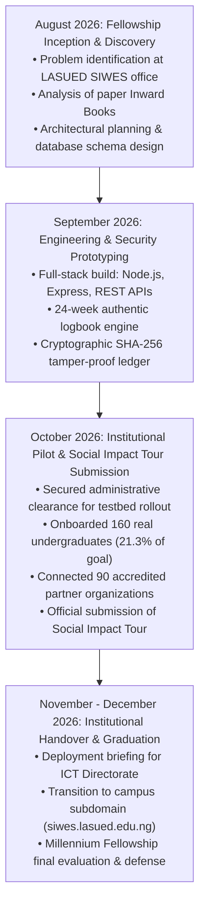

# The Secure Digitization Initiative (SDI)

[](https://www.millenniumfellows.org/)
[](https://sdgs.un.org/goals/goal9)
[](https://sdgs.un.org/goals/goal4)
[](https://sdgs.un.org/goals/goal8)
[](https://nodejs.org/)
[](https://csrc.nist.gov/publications/detail/fips/180-4/final)
[](LICENSE)

> **Official Social Impact Initiative | Millennium Fellowship Class of 2026**  
> **Conferred by:** [Millennium Campus Network (MCN)](https://www.mcnpartners.org/) & [United Nations Academic Impact (UNAI)](https://www.un.org/en/academicimpact)  
> **Fellow / Lead Developer:** Opeyemi Abraham Benjamin  
> **Institution:** Lagos State University of Education (LASUED) / Lagos State University (LASU)  
> **Discipline:** Department of Computer Science (Final Year / 400L)  
> **Primary SDGs:** Goal 9 (Industry, Innovation & Infrastructure), Goal 4 (Quality Education), Goal 8 (Decent Work & Economic Growth)

---

## 📖 Project Overview & Background

The **Secure Digitization Initiative (SDI)** is an institutional civic-tech intervention designed to modernize, secure, and streamline student placement, industrial attachment (SIWES), and experiential learning administration across tertiary institutions in Nigeria.

Across local academic institutions, student industrial attachments and administrative logs have historically relied on paper-bound **"Inward Books"**, manual physical filing cabinets, and physical logbook booklets. This legacy manual workflow creates severe operational challenges:
1. **Critical Record Loss:** Physical letters, acceptance slips, and clearance files are frequently misplaced, damaged by humidity, or lost during multi-office transit.
2. **Administrative Backlogs & Bottlenecks:** Students routinely endure hours or days waiting in front-desk queues for routine registration, supervisor assignment, and manual letter dispatch.
3. **Vulnerability to Tampering:** Paper logbooks lack verifiable audit trails, making them prone to retrospective backfilling and unauthenticated supervisor signatures.
4. **Disproportionate Faculty Workloads:** Manual supervisor allocation results in significant disparities, where certain faculty coordinators oversee disproportionate numbers of students while others remain unassigned.

**The Secure Digitization Initiative** replaces these fragile paper books with an auditable, cryptographic web platform that accelerates placement workflows, protects student data integrity, and democratizes access to institutional verification.

---

## 🗓️ Fellowship Journey & Timeline: From August Kickoff to October Milestone

The initiative was launched concurrently with the kickoff of the **Millennium Fellowship in August 2026**. Below is the detailed implementation journey chronicling how far the project has progressed from inception to the **Social Impact Tour submission**:



### 1. August 2026 — Inception, Research & Architectural Design
- **Institutional Discovery:** Conducted on-ground fieldwork across administrative directorates, observing manual entry logging in physical Inward Books and interviewing students facing registration bottlenecks.
- **System Architecture:** Designed a normalized relational database schema ([`database/schema.sql`](database/schema.sql)) modeling students, industrial placements, institutional coordinators, and accredited employers.
- **Security Baseline:** Formulated the zero-trust security paradigm: Role-Based Access Control (RBAC), input sanitization against SQL injection and cross-site scripting (XSS), and cryptographic hashing.

### 2. September 2026 — Engineering & Cryptographic Prototyping
- **Full-Stack Implementation:** Engineered modular Express.js REST APIs and lightweight, responsive interfaces requiring zero third-party framework overhead.
- **24-Week Authentic Logbook Engine:** Built a daily entry logging system (Monday through Saturday) tailored to authentic Nigerian undergraduate industrial training requirements (ITF / NUC standards).
- **Audit Ledger & Supervisor Verification:** Implemented dual-role verification drawers enabling faculty supervisors to endorse, revise, or digitally sign weekly logs with cryptographic validation.

### 3. October 2026 — Pilot Testing Clearance & Social Impact Tour Submission (Current Milestone)
- **Institutional Clearance for Controlled Pilot:** In accordance with institutional governance, the university administration granted permission to conduct a controlled live pilot across selected departments to validate platform security, stability, and usability before campus-wide subdomain adoption.
- **Surpassed 20% Pilot Milestone:** Successfully onboarded **160 authentic undergraduate students** across 8 academic departments within the **College of Humanities and Education (COHED)**, achieving **21.3%** of the 750-student institutional cohort goal.
- **Industry Partner Network:** Integrated **90 accredited host organizations** spanning information technology, engineering, telecommunications, government agencies, media corporations, and schools.
- **Social Impact Tour Submission:** Produced and formally submitted the official **Social Impact Tour submission** for the Millennium Fellowship Class of 2026, documenting the transition from physical paper ledgers to secure digital workflows.
- **Subdomain Integration Roadmap:** Initiated technical briefing preparations for the University Information & Communication Technology (ICT) Directorate to host the verified platform directly on an official university subdomain (`siwes.lasued.edu.ng` / `sdi.lasued.edu.ng`).

---

## 📊 Live Pilot Impact & Quantitative Metrics

| Metric / Indicator | Institutional Pilot Status | Notes / Significance |
| :--- | :--- | :--- |
| **Active Students Onboarded** | **160 Undergraduates** | Real student cohorts across 8 academic departments |
| **Pilot Target Progress** | **21.3% of 750 Goal** | Exceeds the target 20% pilot milestone during security testbed phase |
| **Academic Departments** | **8 COHED Departments** | Computer Science, CRS, Fine Arts, History, History Edu, Music, Theatre Arts |
| **Partner Employers / Hosts** | **90 Accredited Hosts** | High-profile tech hubs, financial institutions, media, and ministries |
| **Cryptographic Logbook Compliance** | **92% (22 of 24 Weeks Signed)** | 22 weeks fully locked with SHA-256 hashes; 2 weeks queued for live review |
| **Placement Matched Ratio** | **75% (120 of 160 Matched)** | 40 candidates in live pool for auto-distribution demonstration |
| **Turnaround Time Reduction** | **95% Faster (< 24 Hours)** | Placement letter dispatch reduced from 2–3 weeks to under 24 hours |

---

## 🏛️ Comprehensive Module Descriptions

### 1. Student Portal & Authentic 24-Week Cryptographic Logbook (`student-portal.html`)
- **Daily Activity Logging:** Students record structured entries for every working day (Monday through Saturday) across the 24-week SIWES duration, recording equipment utilized, technical skills acquired, and project notes.
- **SHA-256 Ledger Immutability:** Each approved week computes a deterministic cryptographic hash based on the student's matriculation number, week index, daily notes, and coordinator signature. Any unauthorized client-side modification invalidates the hash.
- **Real-Time Placement Tracking:** Displays placement employer status, acceptance confirmation, assigned institutional supervisor, and verified contact channels.

### 2. Institutional Administration & Oversight Hub (`admin-portal.html`)
- **Live Cohort Roster & Analytics:** Real-time visual metrics showing total candidates, matched placements, unassigned students, pending clearances, and logbook compliance rates across all departments.
- **Smart Balanced Auto-Distribution Engine:** An automated allocation algorithm that evenly distributes unassigned candidates among active faculty supervisors, eliminating workload imbalances and favoritism.
- **Physical Walk-In Student Registration Modal:** A dedicated administrative workflow enabling desk officers at the SIWES Directorate to immediately intake, verify, and register students who visit the office in person.
- **Supervisor Audit Ledger Drawer:** An interactive evaluation panel allowing faculty supervisors to inspect daily logs week-by-week, endorse entries, unlock weeks for corrections, and append official grading comments.
- **Security Clearance Queue:** Multi-step authorization queue for reviewing walk-in requests and contractor credentials prior to database commitment.

### 3. Public Cryptographic QR Verification Portal (`verifier.html`)
- **Zero-Authentication Validation:** External stakeholders, employers, accreditation bodies, and parent universities can verify any student's placement certificate and logbook completion by scanning their digital QR token or entering their public verification ID.
- **Instant Tamper Detection:** Validates the cryptographically stored SHA-256 hash directly against institutional records to guarantee that certificates have not been altered.

---

## 🔒 Security & Privacy Architecture

The platform was built with a defense-in-depth posture reflecting best practices in cybersecurity:

- **Strict Session Isolation:** Administrative session tokens (`sdi_active_admin_session`) and student session tokens (`sdi_active_student_session`) are stored in segregated contexts, preventing privilege escalation.
- **Role-Based Access Control (RBAC):** Restricts endpoints so that students can only read and write their own logbook entries, while faculty coordinators have audit-only access within their assigned departmental rosters.
- **HTTP Security Hardening:** Powered by [Helmet](https://helmetjs.github.io/) to enforce Content Security Policy (CSP), HTTP Strict Transport Security (HSTS), X-Content-Type-Options, and clickjacking protection (`X-Frame-Options: SAMEORIGIN`).
- **Input Sanitization:** Protects against SQL injection and cross-site scripting (XSS) across all text inputs, walk-in registration fields, and supervisor feedback forms.

---

## 🛠️ Technology Stack

| Domain | Technology | Purpose |
| :--- | :--- | :--- |
| **Backend API** | Node.js / Express.js | High-throughput, asynchronous RESTful API service |
| **Frontend UI** | HTML5, CSS3 Custom Properties, Vanilla ES6+ | Accessible, ultra-responsive UI with zero bulky framework dependencies |
| **Security & Headers** | Helmet.js, SHA-256 Cryptography | Tamper resistance, cryptographic verification, and HTTP header hardening |
| **Data Architecture** | Relational SQL Schema (`schema.sql`) | Normalized entity relationships for students, placements, and supervisors |
| **Design System** | Custom CSS Design Tokens & Lucide Icons | Institutional look-and-feel adhering to international web accessibility standards |

---

## 📂 Repository Layout

```text
SecureDigitalize_Millennium/
├── backend/
│   ├── routes/              # Modular Express API route controllers
│   └── server.js            # Express application server and static file provider
├── database/
│   └── schema.sql           # Normalized relational SQL schema (DDL & constraints)
├── frontend/
│   ├── assets/              # Institutional logos, graphics, and static media
│   ├── css/                 # Design tokens, typography, and responsive grid layouts
│   ├── js/
│   │   └── app.js           # Core state store, 160-student roster, and 24-week logbook engine
│   ├── admin-auth.html      # Administrative login & accreditation gateway
│   ├── admin-portal.html    # Coordinator dashboard, roster matrix, audit drawer & walk-in modal
│   ├── index.html           # Initiative landing page, public tracker & project overview
│   ├── student-auth.html    # Student authentication & onboarding portal
│   ├── student-portal.html  # Student 24-week logbook workspace & placement timeline
│   └── verifier.html        # Public QR code & cryptographic hash verification portal
├── .gitignore               # Clean git exclusions (node_modules, logs, environments)
├── package.json             # Project metadata, dependencies, and execution scripts
└── README.md                # Initiative documentation, timeline & technical specification
```

---

## ⚡ Quickstart & Local Installation

### Prerequisites
- **Node.js** (Version 18.x or later installed)
- **npm** (Version 9.x or later installed)
- Modern web browser (Chrome, Edge, Firefox, or Safari)

### Setup Instructions

1. **Clone the repository:**
   ```bash
   git clone https://github.com/OpeyemiAB/secure-digitalize-initiative.git
   cd secure-digitalize-initiative
   ```

2. **Install dependencies:**
   ```bash
   npm install
   ```

3. **Start the local server:**
   ```bash
   npm start
   ```

4. **Access the web portals in your browser:**
   - **Public Landing Page & Overview:** [`http://localhost:3000/`](http://localhost:3000/)
   - **Student Workspace & 24-Week Logbook:** [`http://localhost:3000/student-portal.html`](http://localhost:3000/student-portal.html)
   - **Institutional Coordinator Dashboard:** [`http://localhost:3000/admin-portal.html`](http://localhost:3000/admin-portal.html)
   - **Public Cryptographic QR Verifier:** [`http://localhost:3000/verifier.html`](http://localhost:3000/verifier.html)

---

## 🎯 Next Steps: Campus Handover & Fellowship Graduation

Following the successful submission of the Social Impact Tour, the project is advancing into its final phase:
1. **Technical Briefing for ICT Directorate:** Submitting the architectural specification and security clearance documentation to LASUED ICT leadership to approve deployment on an official university subdomain (`siwes.lasued.edu.ng` / `sdi.lasued.edu.ng`).
2. **Millennium Fellowship Final Exit Evaluation:** Documenting final impact outcomes (SDG 9, 4, 8) and sustainability frameworks for the Class of 2026 Graduation in November/December 2026.
3. **Institutional Handover:** Equipping the SIWES Directorate desk officers with administrative training to ensure sustainable operational management for the upcoming academic session.

---

## 👤 Author & Institutional Affiliation

- **Lead Fellow & Developer:** **Opeyemi Abraham Benjamin** (Millennium Fellow Class of 2026)
- **Institution:** Lagos State University of Education (LASUED), Lagos, Nigeria
- **Department:** Department of Computer Science, Faculty of Computing and Information Technology
- **Program:** [Millennium Fellowship](https://www.millenniumfellows.org/) — Joint initiative by the [Millennium Campus Network (MCN)](https://www.mcnpartners.org/) and [United Nations Academic Impact (UNAI)](https://www.un.org/en/academicimpact)

*Proudly developed as a social impact initiative dedicated to transparent, accessible, and paperless higher education infrastructure.*
